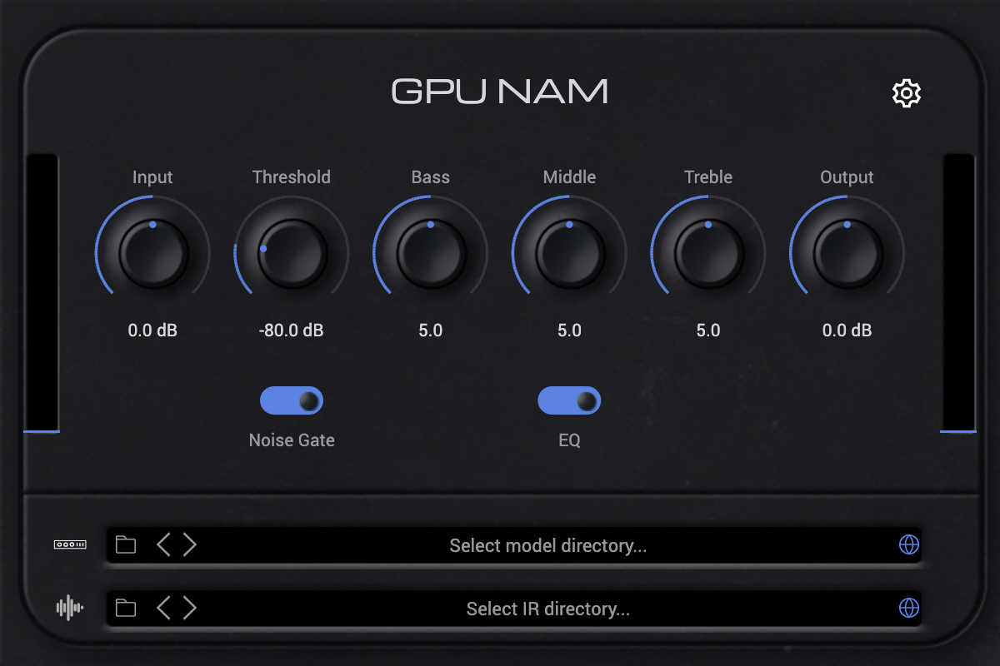

# GPU NAM

GPU NAM is a [Neural Amp Modeler](https://github.com/sdatkinson/neural-amp-modeler)
(`.nam`) player for macOS on Apple Silicon. Load an amp capture and play your
guitar through it as an AU, VST3 or CLAP plugin, or as a standalone app. It runs
the capture on the CPU by default and can run WaveNet captures on the GPU. It is
built on [Pulp](https://github.com/Generous-Corp/pulp), and every release is
signed and notarized.



## Who it's for

Use GPU NAM if you:

- play through `.nam` captures and want a light, fast player;
- want the same sound NAM players produce, at a lower CPU cost per instance;
- want to try running large WaveNet captures on the GPU;
- build audio software on Pulp and want a complete plugin to read.

## Install

Download the installer from [Releases](https://github.com/danielraffel/pulp-gpu-nam/releases)
and run it. Pick the formats you want in the installer's Customize pane, then
rescan plugins in your DAW. A small example capture is bundled, so the plugin makes
sound immediately.

Click the model slot to load your own `.nam` file, or use the ‹ / › arrows to step
through the captures in the same folder. The cabinet slot loads a `.wav`, `.aiff`
or `.flac` impulse response.

## What it loads

WaveNet (A1 and A2), ConvNet, LSTM and Linear `.nam` captures, plus RTNeural/Keras
`.json` GRU and LSTM models. Conditioned (parametric) captures are rejected with a
message rather than played wrong. Details: [docs/nam-support.md](docs/nam-support.md).

## Key numbers

Measured on an M5 Max, one instance, 48 kHz:

- **CPU cost.** A standard WaveNet capture takes 22 us per 64-sample block,
  about 1.6% of one core. That is 8.9x faster than GPU NAM 1.2.4; an LSTM
  capture is 4.9x faster.
- **Sound.** The output matches the reference NAM engine with fast tanh on, the
  setting NAM players ship with, to float rounding (-85 dB or lower, typically
  below -100 dB). At that output it is 1.1-1.9x faster than the reference.
- **GPU.** On a very large WaveNet (48 channels, 32 layers, 4096-sample blocks)
  the GPU engine takes 6-7 ms per block, against 43-47 ms for the CPU engine
  with exact tanh. On standard-size captures the CPU engine is faster, so it is
  the default.

Details and method: [docs/performance.md](docs/performance.md).

## How it works

```
input gain -> noise gate -> NAM model (CPU, or GPU for WaveNet)
           -> tone stack -> cabinet IR -> DC blocker -> output level -> dry/wet mix
```

The CPU engine runs each layer over a whole block of samples with small,
register-blocked matrix products, so the weights stay in cache and the
activations run on whole arrays. The GPU engine runs the entire WaveNet forward
pass for a block in one GPU submission over weights already on the device, so
the CPU-to-GPU round trip is paid once per block. More: [docs/how-it-works.md](docs/how-it-works.md).

## Build from source

```bash
git clone https://github.com/danielraffel/pulp-gpu-nam.git && cd pulp-gpu-nam
git submodule update --init --recursive
./scripts/fetch-sdks.sh            # VST3 + AU SDKs (CLAP and standalone need none)
cmake -S . -B build -DCMAKE_BUILD_TYPE=Release
cmake --build build --target GpuNam_Standalone GpuNam_CLAP GpuNam_VST3 GpuNam_AU -j8
```

Tests, smaller builds and packaging: [docs/building.md](docs/building.md).

## What it doesn't do

- It does not train captures. Use the NAM trainer for that.
- It runs only on macOS on Apple Silicon.
- The GPU engine covers WaveNet A1 only. A2, ConvNet, LSTM, Linear and Keras
  captures run on the CPU.
- It does not play conditioned (parametric) captures.

## Documentation

- [docs/nam-support.md](docs/nam-support.md): supported architectures, engines,
  tanh modes, signal chain
- [docs/performance.md](docs/performance.md): how the CPU engine was measured and
  compared
- [docs/how-it-works.md](docs/how-it-works.md): the CPU and GPU engines and how
  the plugin sits on Pulp
- [docs/building.md](docs/building.md): build, test, package
- [docs/README.md](docs/README.md): every other document, including validation
  records

## License and attribution

GPU NAM is MIT-licensed ([LICENSE.md](LICENSE.md)). The editor is an independent
recreation of [NeuralAmpModelerPlugin](https://github.com/sdatkinson/NeuralAmpModelerPlugin)'s
face panel in Pulp's view and canvas, and no UI code from that plugin is used. Its
image and font assets are reused under their own MIT, OFL and Apache licenses; see
[src/assets/nam/ATTRIBUTION.md](src/assets/nam/ATTRIBUTION.md). Bundled captures
and the rational tanh coefficients come from the MIT-licensed NeuralAmpModelerCore;
see [src/models/ATTRIBUTION.md](src/models/ATTRIBUTION.md). The "Neural Amp
Modeler" name and wordmark are trademarks and are not used as branding.
